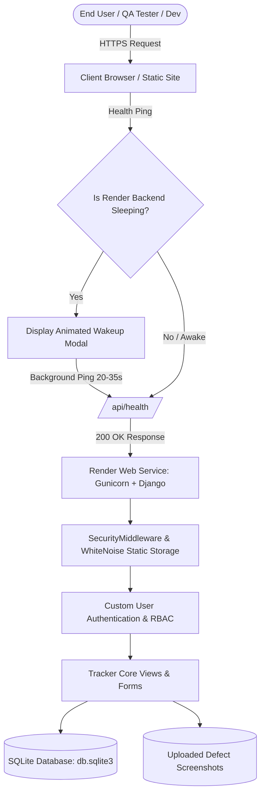
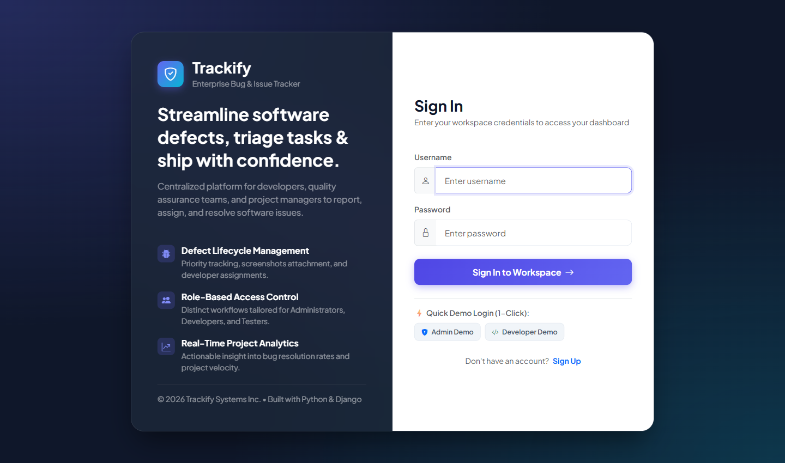
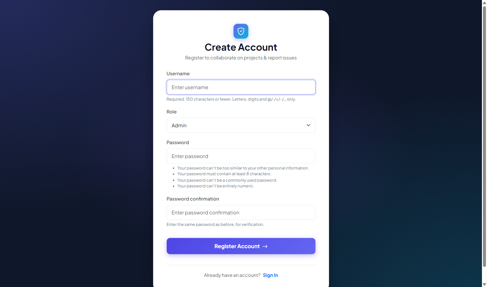
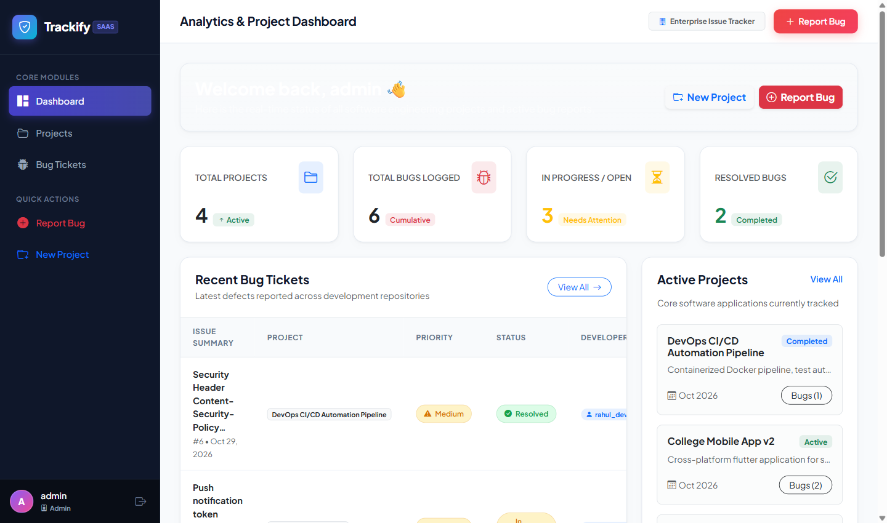
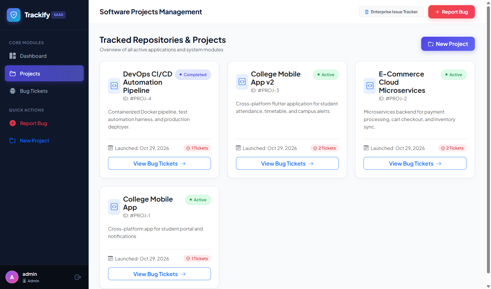
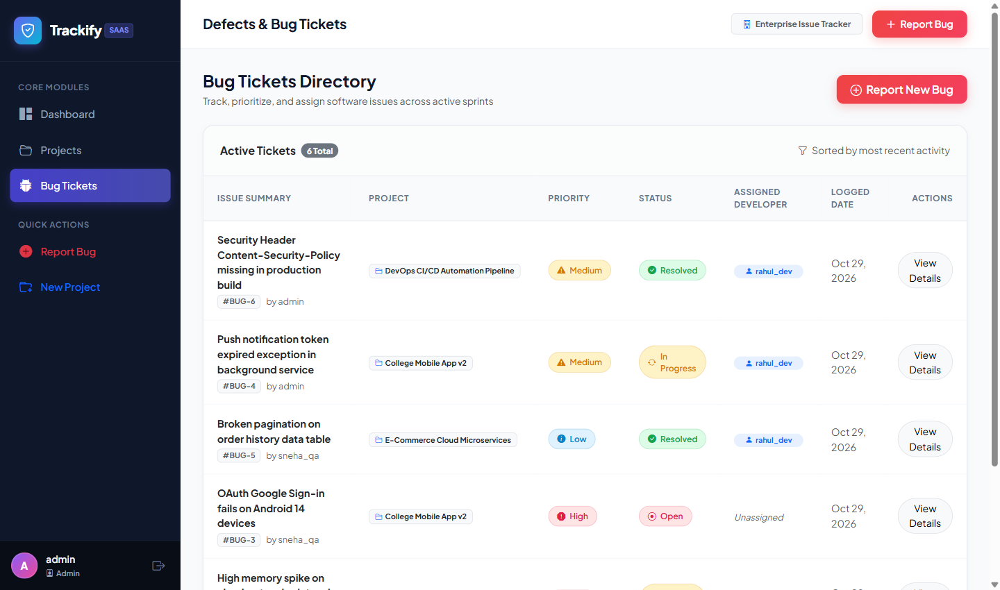
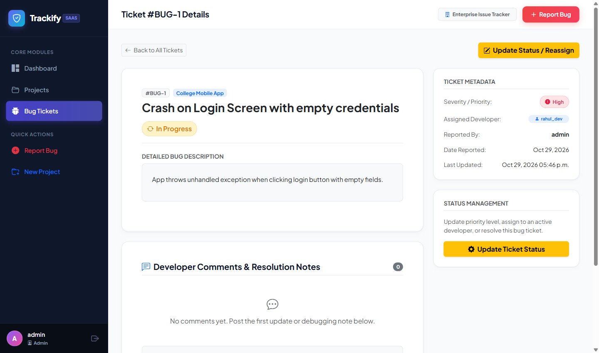
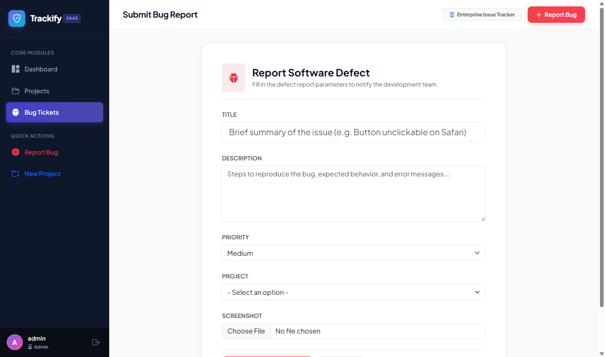

# 🛡️ Trackify - Enterprise Software Bug & Issue Tracking Ecosystem

[](https://www.python.org/)
[](https://www.djangoproject.com/)
[](https://www.sqlite.org/)
[](https://getbootstrap.com/)
[](https://render.com/)

**Trackify** is an enterprise-grade, full-stack defect lifecycle and issue management platform designed for modern software engineering teams. Built using **Python, Django, SQLite, and Bootstrap 5.3**, Trackify provides end-to-end bug logging, developer assignment workflows, severity triage, screenshot evidence handling, real-time analytics dashboards, and an automated **Render Free Tier Zero-Delay Wakeup Mechanism**.

---

## 📑 Table of Contents
1. [Academic Problem Statement & Relevance](#-academic-problem-statement--relevance)
2. [System Architecture](#-system-architecture)
3. [Key Features by User Role](#-key-features-by-user-role)
4. [Render Free-Tier Auto-Wakeup Mechanism](#-render-free-tier-auto-wakeup-mechanism)
5. [Visual Interface Gallery (Screenshots)](#-visual-interface-gallery-screenshots)
6. [Database Schema & Entity Relationship](#-database-schema--entity-relationship)
7. [Local Setup & Installation Guide](#-local-setup--installation-guide)
8. [Step-by-Step Render Deployment](#-step-by-step-render-deployment)
9. [Pre-Populated Demo Credentials](#-pre-populated-demo-credentials)
10. [Authors & Project Representation](#-authors--project-representation)

---

## 🎯 Academic Problem Statement & Relevance

In modern Software Development Life Cycle (SDLC) methodologies (Agile/Scrum), managing software defects through unstructured channels like spreadsheets or communication channels leads to:
* **Untracked Critical Bugs:** High-severity runtime defects get lost in communication threads.
* **Lack of Accountability:** Unclear developer assignment and absence of an audit log for ticket resolutions.
* **Zero Visibility:** Project managers cannot quantify defect density or project stability.

**Trackify** solves this by establishing a structured, role-based defect management pipeline where quality assurance testers log reproducible defects with visual proof, project managers assign workloads based on priority, and developers diagnose and patch issues with timestamped resolution notes.

---

## 🏗️ System Architecture



---

## 🚀 Key Features by User Role

### 1. 🛡️ Administrator / Project Manager
* **Project Directory Management:** Provision software repositories (Active, Completed, On Hold).
* **Defect Assignment Engine:** Allocate incoming defect tickets directly to available developers.
* **Executive Metrics Dashboard:** Live KPI cards displaying Total Projects, Total Bugs Logged, In Progress tickets, and Resolved bug ratios.

### 2. 👨‍💻 Software Engineer / Developer
* **Assigned Tickets Queue:** Personalized view of bugs prioritized for immediate patching.
* **Status Lifecycle Progression:** Update ticket state from `Open` ➔ `In Progress` ➔ `Resolved`.
* **Technical Collaboration Log:** Append debugging updates, root-cause analyses, and patch commit hashes in ticket comment threads.

### 3. 🔍 QA Engineer / Tester
* **Detailed Defect Reporting:** Log issues with title, reproduction steps, severity level (`High`, `Medium`, `Low`), and software module.
* **Visual Evidence Attachment:** Upload failure screenshots directly for diagnostic clarity.

---

## ⚡ Render Free-Tier Auto-Wakeup Mechanism

Free cloud hosting platforms (such as Render) automatically suspend / spin down inactive web services after 15 minutes of inactivity. When a new user hits the service, spinning up instances can take 20 to 45 seconds, often resulting in browser 502/504 gateway timeout errors.

**Trackify features an intelligent proactive warm-up solution:**
1. **Instantaneous DOM Handshake:** As soon as the frontend loads, a non-blocking asynchronous `fetch('/api/health/')` ping is dispatched to the backend.
2. **Dynamic Sleep Detector:** If the backend does not respond within 1.5 seconds, an animated glassmorphic overlay automatically appears:
   > *"⚡ Waking Up Server... Render Free Tier is booting instances. Elapsed: Xs (Est: 20-35s)"*
3. **Automatic Auto-Dismissal:** As soon as the backend returns `200 OK`, the modal seamlessly closes, and a success toast confirms connection readiness.
4. **Zero Authentication Failures:** Users are shielded from timeout errors, ensuring clean login and flawless demonstration during viva evaluations.

---

## 📸 Visual Interface Gallery (Screenshots)

### 1. Modern SaaS Sign In Screen (with 1-Click Demo Buttons)


### 2. Account Registration & Role Selection


### 3. Real-Time Analytics & Defect Dashboard


### 4. Software Projects & Repository Overview


### 5. Centralized Defect & Bug Tickets Directory


### 6. Defect Inspection, Screenshot & Developer Comments


### 7. Comprehensive Defect Logging & File Upload Form


---

## 🗄️ Database Schema & Entity Relationship

```
+-------------------------------------------------------------+
|                         User (AbstractUser)                 |
+-------------------------------------------------------------+
| id (PK) | username | email | password | role (admin/dev/qa) |
+-------------------------------------------------------------+
                             | 1
                             |
                             | N
+-------------------------------------------------------------+
|                          Project                            |
+-------------------------------------------------------------+
| id (PK) | name | description | start_date | status          |
+-------------------------------------------------------------+
                             | 1
                             |
                             | N
+-------------------------------------------------------------+
|                          Ticket                             |
+-------------------------------------------------------------+
| id (PK)             | title           | description         |
| priority (L/M/H)    | status (O/IP/R) | screenshot          |
| project_id (FK)     | creator_id (FK) | assigned_dev_id(FK) |
| created_at          | updated_at                            |
+-------------------------------------------------------------+
                             | 1
                             |
                             | N
+-------------------------------------------------------------+
|                          Comment                            |
+-------------------------------------------------------------+
| id (PK) | ticket_id (FK) | user_id (FK) | content | created |
+-------------------------------------------------------------+
```

---

## 💻 Local Setup & Installation Guide

### Prerequisites
* Python 3.10, 3.11, or 3.12 installed
* Git installed

### 1. Clone the Repository
```bash
git clone https://github.com/khanshadab33900-svg/trackify.git
cd trackify
```

### 2. Create and Activate Virtual Environment
```bash
# Windows
python -m venv venv
.\venv\Scripts\activate

# macOS / Linux
python3 -m venv venv
source venv/bin/activate
```

### 3. Install Required Dependencies
```bash
pip install -r requirements.txt
```

### 4. Run Migrations & Start Server
```bash
python manage.py migrate
python manage.py runserver
```

Open your browser at **`http://127.0.0.1:8000/`**.

---

## ☁️ Step-by-Step Render Deployment

### Option A: Full-Stack Web Service on Render (Recommended)
1. Fork or push this repository to your GitHub account: `https://github.com/khanshadab33900-svg/trackify.git`.
2. Log into [Render Dashboard](https://dashboard.render.com/) and click **New +** ➔ **Web Service**.
3. Connect your GitHub repository.
4. Configure the service settings:
   * **Name:** `trackify-app` (or any custom name)
   * **Region:** Oregon (US West) or Singapore
   * **Branch:** `main` (or `master`)
   * **Runtime:** `Python 3`
   * **Build Command:** `./build.sh` (or `pip install -r requirements.txt && python manage.py collectstatic --no-input && python manage.py migrate`)
   * **Start Command:** `gunicorn bug_tracker.wsgi:application`
   * **Plan Type:** `Free`
5. Click **Create Web Service**. Your application will be live in 2-3 minutes!

### Option B: Backend on Render + Frontend on Static Site (Vercel / Netlify)
1. Deploy the backend on Render as a Web Service using Option A above.
2. In `frontend_static/index.html`, enter your live Render URL (e.g. `https://trackify-app.onrender.com`).
3. Deploy `frontend_static/` to Vercel, Netlify, or Render Static Site in 1 click!

---

## 🔑 Pre-Populated Demo Credentials

For live demonstration, evaluation panels, and viva assessments:

| Role | Username | Password | Purpose |
| :--- | :--- | :--- | :--- |
| **System Admin** | `admin` | `admin123` | Full system access, project provisioning, developer assignment |
| **Lead Developer** | `rahul_dev` | `admin123` | Ticket status updates, debugging notes, code comments |
| **QA / Tester** | `sneha_qa` | `admin123` | Bug reporting, screenshot uploads, defect tracking |

---

## 👨‍💻 Project Information & License

* **Project:** Final Year Computer Science & Engineering Capstone Project
* **Architecture:** Model-View-Template (MVT) Pattern
* **License:** [MIT License](LICENSE)
